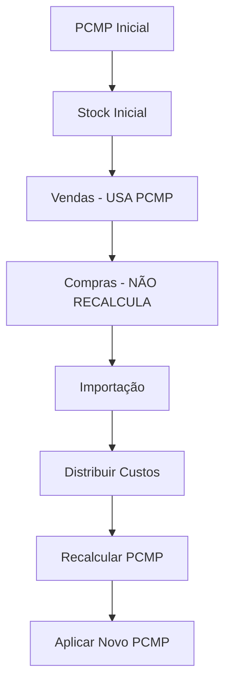

# MH Purchase - PCMP Management

Módulo completo para gestão de compras com **PCMP (Preço Custo Médio Ponderado)** no Odoo 18.

## Funcionalidades

### 🎯 Método de Custeio PCMP
- Adiciona PCMP como novo método de custeio (além de Standard, FIFO, AVCO)
- Suporte completo a produtos com lotes
- Integração total com `stock.valuation.layer`

### 📊 PCMP Inicial
- Definição de PCMP inicial por produto/lote/armazém/ano
- Base para cálculos de custo médio ponderado
- Controlo de estado (rascunho → confirmado → em uso)

### 📦 Stock Inicial
- Documento para registo de stock inicial
- Aplica PCMP inicial automaticamente
- Suporte a produtos com e sem lotes

### 🚢 Documentos de Importação
- Gestão completa de processos de importação
- Diferentes tipos de PO (mercadoria, frete, impostos, etc.)
- Distribuição automática de custos adicionais
- Recálculo de PCMP com fórmula específica

## Como Usar

### 1. Configuração Inicial

1. **Configurar Categoria de Produto:**
   - Ir para Inventário → Configuração → Categorias de Produto
   - Escolher categoria e definir **Método de Custeio = PCMP**

2. **Definir PCMP Inicial:**
   - Menu: PCMP Management → Configuração PCMP → PCMP Inicial
   - Criar registos para cada produto/armazém/ano
   - Estado: Rascunho → Confirmar

### 2. Stock Inicial

1. **Criar Stock Inicial:**
   - Menu: PCMP Management → Configuração PCMP → Stock Inicial
   - Adicionar linhas com produtos e quantidades
   - **Validar** → aplica PCMP inicial automaticamente

### 3. Operações Diárias

**Vendas:**
- Usam PCMP atual **sem recalcular**
- Cada lote mantém seu PCMP específico

**Compras Normais:**
- Registam entrada mas **não alteram PCMP**

### 4. Importações

1. **Criar Documento de Importação:**
   - Menu: PCMP Management → Operações → Documentos de Importação
   - Adicionar produtos importados

2. **Fluxo de Estados:**
   ```
   Rascunho → Em Trânsito → Mercadoria Recebida →
   Calculando Custos → Recalcular PCMP → Finalizado
   ```

3. **Adicionar Custos de Serviços:**
   - Criar POs com `service_type` = Frete, Impostos, etc.
   - Associar ao documento de importação

4. **Calcular Custos:**
   - Distribui custos adicionais proporcionalmente
   - Calcula custo unitário final

5. **Recalcular PCMP:**
   - Aplica fórmula: `(PCMP_inicial × Qty_inicial) - (Vendas × PCMP_atual) + (Importação × Custo_final) / (Qty_inicial - Vendas + Importação)`

## Estrutura Técnica

### Modelos Principais

- `stock.pcmp.initial` - PCMP inicial por produto/lote/ano
- `stock.initial` - Documento de stock inicial
- `import.document` - Documento de importação
- `import.document.line` - Linhas de produtos importados

### Extensões

- `product.category` - Adiciona método PCMP
- `product.product` - Lógica PCMP
- `purchase.order` - Tipos de serviço
- `stock.move` - Suporte PCMP em movimentos
- `stock.valuation.layer` - Rastreabilidade PCMP
- `stock.lot` - PCMP por lote

### Campos Importantes

- `product.category.property_cost_method` - Inclui 'pcmp'
- `stock.lot.standard_price` - PCMP do lote
- `stock.move.is_initial_stock` - Movimento de stock inicial
- `stock.move.import_document_id` - Ligação a importação

## Fluxo PCMP



## Menus

- **PCMP Management** (sob Inventário)
  - **Configuração PCMP**
    - PCMP Inicial
    - Stock Inicial
  - **Operações**
    - Documentos de Importação

## Instalação

1. Copiar módulo para `addons/`
2. Reiniciar Odoo
3. Ir para Apps → Atualizar Lista de Apps
4. Procurar "MH Purchase" → Instalar

## Dependências

- `base`
- `stock`
- `stock_account`
- `purchase`
- `product`

## Versão

**18.0.1.0.0** - Compatível com Odoo 18

---

© 2024 MH - Todos os direitos reservados